<picture><source media="(prefers-color-scheme: dark)" srcset="./banner-dark.svg"></picture>

I'm **Rémy Agez**, a developer and first-year master's (M1) engineering student at JUNIA ISEN, and the founder of **Ave Corp**.

I build my own development environment: a dashboard that runs a team of specialised AI agents, a shared memory they read before every task, a voice copilot, and a video montage engine. Agents draft, code and check; every change goes through a plan, tests and a review, and I decide what ships.

Through Ave Corp, the same tools also build fast websites and custom tools for small businesses.

### What I'm building

| Project | What it is | Stack |
|---|---|---|
| **Agent Office** | The dashboard that runs the agents: live missions, token budget guard, project costs, night runs with a morning review, phone alerts, a map of the shared memory. | Next.js 16 · React · TypeScript · SSE |
| **Stella** | Voice copilot for the PC: wake word, local speech-to-text, arranges windows across screens, learns routines. Asks out loud before anything sensitive. | Python · faster-whisper · Edge TTS · Claude |
| **Mail assistant** | Reads the inbox, labels and archives the noise, drafts replies with a per-contact memory I can edit. A mail only leaves when I click send. | Gmail API · Next.js · Claude |
| **Agent harness** | 49 agents and 67 skills sharing one workflow (spec, plan, build, test, review), synced across machines and covered by tests. | Node.js · Python · Claude Code |
| **Shared memory** | An Obsidian vault the agents read before work and write to after, so no session starts from zero. | Markdown · Python |
| **Autonomous cell** | Agents that keep working at night on their own: a cockpit that relaunches them after limits, a judge that scores every output, a morning page where I review, approve or send back. | Node.js · Next.js · Claude Code |
| **Inspiration skills** | Skills in active development that learn a style from references (an edit, a website, a thumbnail), list what makes it work, and rebuild new pieces with the same recipe. | Python · ffmpeg · Playwright |
| **Workshop** | Work sessions with Claude inside the dashboard, reachable from my phone over a private network. In progress. | Next.js · Tailscale · WebAuthn |
| **Video and montage engine** | Studies a reference edit (cuts, effects, music sync, grading), then builds new edits in the same style, scored by an independent judge. | Python · ffmpeg · OpenCV |
| **Small-business sites** | Fast static sites for local trades: SEO, structured data, accessibility first. | HTML/CSS · Cloudflare Pages |

Project repositories above are private, happy to walk through the code. Open-source tools are public.

### Open source

**[safe-to-share](https://github.com/Ave-FR/safe-to-share)**: check documents before you share them or hand them to an AI. `clean` strips hidden metadata (author, company, GPS position in photos, software names, invisible characters); `scan` finds hidden prompt injections (white or tiny text, invisible characters, "if you are an AI…") and lists them without following them. A whole folder in one command, a clear report, nothing leaves your machine. Python · MIT · README in English and French.

### How I work

- **Spec before code.** Every non-trivial feature gets a written plan that another agent challenges before anyone builds it.
- **Evidence over confidence.** Done means tests ran and a screenshot was checked, not that an agent said so.
- **Small diffs.** The smallest change that fully solves the problem, with a test for any new logic.
- **Human in the loop.** Anything that leaves the machine (a mail, a post, a payment) waits for my click.
- **Cost-aware.** Every token is tracked per project; a guard stops runs that blow the budget.

### Stack

       

### Contact

[contact@avecorp.fr](mailto:contact@avecorp.fr)

En français : élève ingénieur à JUNIA ISEN et fondateur d'Ave Corp, je réalise des sites et des outils sur mesure pour les petites entreprises. Écrivez-moi à la même adresse.
