I build the tooling that lets AI agents handle the day-to-day of a small company: planning, coding, reviewing, shipping, and remembering what happened yesterday. The company is me; the staff is ~45 specialised Claude Code agents.

### What I'm building

| Project | What it is | Stack |
|---|---|---|
| **Agent Office** | Pixel-art dashboard that drives the agents: live missions, token budget guard, project costs, night runs with a morning review. | Next.js 16 · React · TypeScript · SSE |
| **Agent harness** | ~45 agents and ~50 skills with one shared workflow (spec → plan → build → test → review), synced across machines and checked by tests. | Node.js · Python · Claude Code |
| **Shared memory** | An Obsidian vault the agents read before work and write to after, so no session starts from zero. | Markdown · Python |
| **Small-business sites** | Fast static sites for local trades: SEO, structured data, accessibility first. | HTML/CSS · Cloudflare Pages |

Repositories are private. Happy to walk through the code.

### Stack

       

### How I work

- **Spec before code.** Every non-trivial feature gets a written plan that another agent challenges before anyone builds it.
- **Evidence over confidence.** Done means tests ran and a screenshot was checked, not that an agent said so.
- **Small diffs.** The smallest change that fully solves the problem, with a test for any new logic.
- **Cost-aware.** Every token is tracked per project; a guard stops runs that blow the budget.
